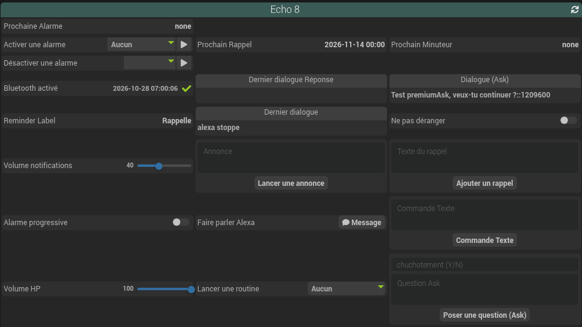
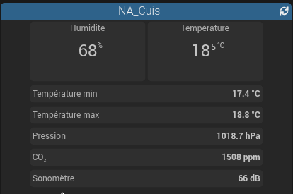
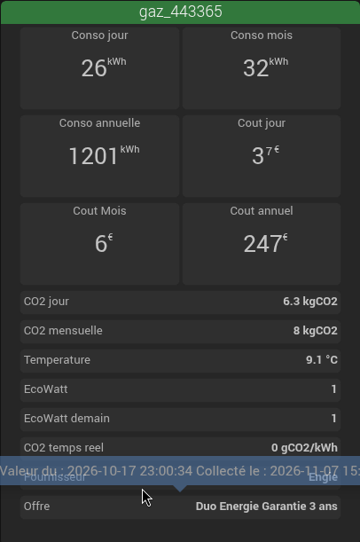
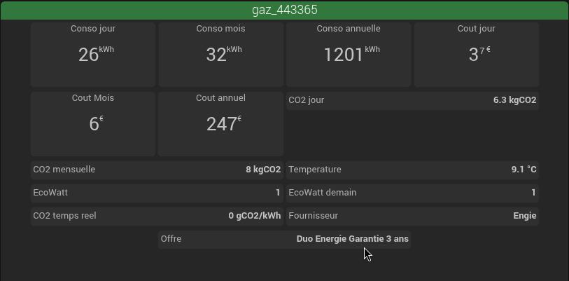
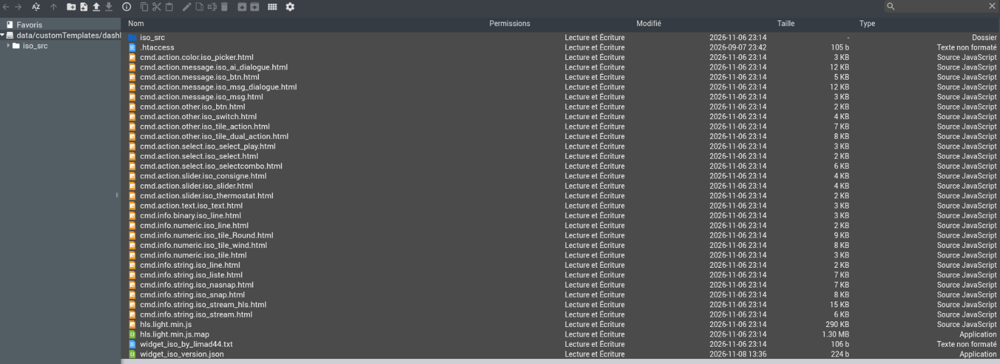
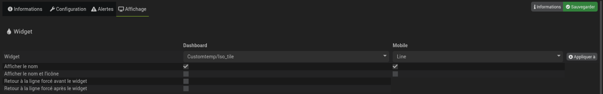

# widget-iso

Pack de widgets dashboard pour **Jeedom** (4.4 et plus), par Limad44.

Les widgets « iso » remplacent l'affichage par défaut des commandes sur le dashboard par un rendu homogène et compact : lignes alignées, tuiles, listes, curseurs, sélecteurs, zones de message, caméras. Les commandes d'un équipement s'alignent ligne par ligne, sur les mêmes bords, et s'adaptent au thème clair ou sombre de Jeedom.





La disposition s'adapte à la largeur de l'équipement. Le même équipement, en étroit puis en large :





## Contenu du pack

Le pack est distribué dans l'archive [`widget_iso.zip`](widget_iso.zip). Elle contient :

- les widgets, un fichier par widget : `cmd.<type>.<sous-type>.iso_<nom>.html` ;
- `iso_src/` : la feuille de style commune (`cmd.iso.css`), les scripts partagés, les polices, le sélecteur de date, et `custom.iso.css` pour vos personnalisations ;
- `hls.light.min.js` : lecteur vidéo utilisé par le widget `iso_stream_hls`.

| Type de commande | Widgets |
|---|---|
| Info numérique | `iso_line`, `iso_tile`, `iso_tile_Round`, `iso_tile_wind` |
| Info binaire | `iso_line` |
| Info texte | `iso_line`, `iso_liste`, `iso_snap`, `iso_nasnap`, `iso_stream`, `iso_stream_hls` |
| Action défaut | `iso_btn`, `iso_switch`, `iso_tile_action`, `iso_tile_dual_action` |
| Action curseur | `iso_slider`, `iso_consigne`, `iso_thermostat` |
| Action liste | `iso_select`, `iso_select_play`, `iso_selectcombo` |
| Action message | `iso_msg`, `iso_btn`, `iso_msg_dialogue`, `iso_ai_dialogue` |
| Action couleur | `iso_picker` |
| Action texte | `iso_text` |

Certains widgets acceptent des paramètres optionnels (taille, couleurs, pas du curseur…). Ils sont listés dans la configuration de la commande, onglet **Affichage**, section **Paramètres optionnels widget**.

## Installation manuelle

Plusieurs plugins de Limad44 installent ce pack automatiquement. Sans ces plugins, installez-le à la main.

Le pack s'installe dans le dossier des templates personnalisés de Jeedom :

```
/var/www/html/data/customTemplates/dashboard/
```

Les fichiers doivent se trouver **directement** dans ce dossier (pas dans un sous-dossier `widget_iso/`).

### Méthode 1 : éditeur de fichiers Jeedom (sans SSH)

1. Téléchargez [`widget_iso.zip`](https://github.com/limad/widget-iso/raw/beta/widget_iso.zip) sur votre ordinateur.
2. Dans Jeedom, ouvrez **Réglages → Système → Éditeur de fichiers**.
3. Allez dans `data` → `customTemplates` → `dashboard`.
4. Cliquez sur l'icône **Envoyer les fichiers** (flèche vers le haut) et envoyez `widget_iso.zip`.
5. Clic droit sur `widget_iso.zip` → **Extraire les fichiers de l'archive**. Extrayez dans le dossier courant, pas « Dans un nouveau dossier ».
6. Vérifiez que les fichiers `cmd.….iso_….html` et le dossier `iso_src` sont bien à la racine de `dashboard`, puis supprimez `widget_iso.zip`. Si un sous-dossier a été créé, déplacez son contenu dans `dashboard`.

Résultat attendu :



### Méthode 2 : en ligne de commande (SSH)

```bash
cd /tmp
wget -O widget_iso.zip https://github.com/limad/widget-iso/raw/beta/widget_iso.zip
sudo unzip -o widget_iso.zip -d /var/www/html/data/customTemplates/dashboard
sudo chown -R www-data:www-data /var/www/html/data/customTemplates
rm widget_iso.zip
```

### Mise à jour

Recommencez la même procédure : les fichiers du pack sont remplacés.

**Avant de mettre à jour, sauvegardez `iso_src/custom.iso.css`** si vous l'avez modifié : l'archive contient une version vide de ce fichier, qui remplacerait la vôtre. Remettez votre copie en place après l'extraction.

Rechargez ensuite le dashboard en vidant le cache du navigateur (Ctrl+F5).

## Appliquer un widget à une commande

1. Ouvrez la configuration de la commande (roue crantée de la commande dans la page de l'équipement).
2. Onglet **Affichage**, ligne **Widget**, colonne **Dashboard** : choisissez `Customtemp/Iso_…`. La liste ne propose que les widgets compatibles avec le type et le sous-type de la commande.
3. Sauvegardez, puis rechargez le dashboard.



Les widgets en ligne (`iso_line`, `iso_btn`, `iso_slider`, `iso_select`, etc.) occupent toute la largeur de l'équipement. Si l'alignement n'est pas correct, cochez **Retour à la ligne forcé avant le widget** et **après le widget**.

## Personnalisation

Ne modifiez pas les fichiers du pack : ils sont remplacés à chaque mise à jour.

Placez vos règles CSS dans `iso_src/custom.iso.css`. Ce fichier est chargé après la feuille principale et ses règles l'emportent. Le guide `iso_src/custom_iso_css_doc.md` (inclus dans l'archive) décrit la disposition et les variables disponibles : largeur des widgets, marges, couleurs, arrondis, tailles de texte.

Exemple, des widgets plus larges sur grand écran (une ligne fait 410 px au lieu de 328 px) :

```css
@media (min-width: 1025px) {
    .cmd-widget.widget-iso {
        --nbStep: 5;
    }
}
```

## Désinstallation

Remettez le widget **Défaut** sur les commandes concernées, puis supprimez les fichiers `cmd.*.iso_*.html`, `hls.light.min.js*`, `widget_iso_by_limad44.txt` et le dossier `iso_src` de `data/customTemplates/dashboard/`.
